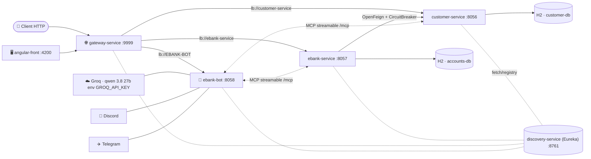

<div align="center">

# 🏦 EBank MCP Agent Platform

**Architecture Microservices · Systèmes Distribués**

[](https://www.oracle.com/java/)
[](https://spring.io/projects/spring-boot)
[](https://spring.io/projects/spring-cloud)
[](https://github.com/Netflix/eureka)
[](https://resilience4j.readme.io/)
[](https://springdoc.org/)
[](https://h2database.com/)
[](https://angular.dev/)
[](https://docs.spring.io/spring-ai/reference/)

</div>

---

## 📖 Vue d'ensemble

**EBank MCP Agent Platform** est une plateforme de gestion bancaire construite sur une **architecture microservices**. Chaque fonctionnalité métier est isolée dans un service indépendant, déployable séparément, qui s'enregistre auprès d'un registre de services et communique avec les autres à travers des appels déclaratifs.

Le projet met en œuvre les fondations essentielles d'un système distribué :

- ✅ **Isolation des responsabilités** — un microservice métier par domaine (clients, comptes bancaires)
- ✅ **Service Registry** — enregistrement et découverte dynamique des services avec **Netflix Eureka**
- ✅ **API Gateway** — point d'entrée unique avec routage statique et dynamique via **Spring Cloud Gateway (WebFlux)**
- ✅ **Communication interservices** — appels REST déclaratifs via **OpenFeign**
- ✅ **Agent IA** — assistant bancaire alimenté par un **LLM (Groq/Qwen)** connecté aux services via le protocole **MCP (Model Context Protocol)**, disponible sur le web, **Discord** et **Telegram**
- ✅ **Frontend Angular** — interface web moderne : liste des comptes et chatbot streaming
- ✅ **Résilience** — pattern **Circuit Breaker (Resilience4j)** avec fallback pour absorber les pannes de service
- ✅ **Documentation API** — **Swagger UI (springdoc-openapi)** pour explorer et tester chaque endpoint
- ✅ **Observabilité** — exposé des métriques et du monitoring via **Spring Boot Actuator**

## 🧱 Architecture



1. Le **client** ne dialogue qu'avec la **Gateway** — jamais en direct avec les microservices.
2. La **Gateway** découvre les services enregistrés dans **Eureka** et répartit les requêtes dynamiquement.
3. `ebank-service` complète les informations de ses comptes bancaires en interrogeant `customer-service` via **OpenFeign** ; si ce dernier est indisponible, le **Circuit Breaker** bascule sur un fallback sans faire tomber la plateforme.

## 🧩 Services

| # | Service | Rôle | Port | Sources |
|---|---------|------|------|---------|
| 1 | 🧍 `customer-service` | Gestion des clients de la banque (CRUD REST + JPA) | `8056` | [`customer-service/`](customer-service) |
| 2 | 🏦 `ebank-service` | Gestion des comptes bancaires, enrichissement des comptes avec les données client | `8057` | [`ebank-service/`](ebank-service) |
| 3 | 🧭 `discovery-service` | Registre de services **Netflix Eureka** — tous les services s'y enregistrent | `8761` | [`discovery-service/`](discovery-service) |
| 4 | 🌐 `gateway-service` | **API Gateway** — routage statique & dynamique des requêtes entrantes | `9999` | [`gateway-service/`](gateway-service) |
| 5 | 🤖 `ebank-bot` | **Agent IA** — ChatClient LLM + outils MCP des services, bots Discord & Telegram, streaming | `8058` | [`ebank-bot/`](ebank-bot) |
| 6 | 🖥️ `angular-front` | **Interface web** — liste des comptes + chatbot (UI streaming) | `4200` | [`angular-front/`](angular-front) |

## 🛠️ Stack technique

| Technologie | Version | Usage |
|---|---|---|
| ☕ Java | 17 / 21 | Runtime & compilation |
| 🌱 Spring Boot | 4.1.1 | Socle applicatif des microservices |
| ☁️ Spring Cloud | 2025.1.3 | Config, Eureka, Gateway, OpenFeign, CircuitBreaker |
| 🧭 Netflix Eureka | Spring Cloud Netflix | Service registry / service discovery |
| 🔌 OpenFeign | Spring Cloud | Clients REST déclaratifs interservices |
| 🛡️ Resilience4j | Spring Cloud CircuitBreaker | Circuit Breaker & fallbacks |
| 💽 H2 Database | 2.x | Base de données en mémoire du microservice (client et service ebank) |
| 📄 springdoc-openapi | 3.1.1 | Documentation Swagger UI des APIs |
| 📦 Lombok | — | Génération de code (getters, builders…) |
| 📈 Spring Boot Actuator | — | Endpoints de monitoring (`/actuator`) |

## 🚀 Démarrage rapide

### Prérequis

- **Java 17+** (recommandé : Java 21)
- **Git** 
- ⚠️ Maven n'est pas nécessaire : chaque module embarque le **Maven Wrapper** (`mvnw`)

### 1️⃣ Cloner le projet

```bash
git clone https://github.com/saadaitsaid26/ebank-agentic-microservices.git
cd ebank-agentic-microservices
```

### 2️⃣ Lancer les services (respecter l'ordre)

> Le registre doit démarrer en premier : les microservices s'y enregistreront à leur lancement.

```bash
# 1. Service Registry (Eureka)
cd discovery-service
./mvnw spring-boot:run          # Windows : mvnw.cmd spring-boot:run

# 2. Microservice Clients (nouveau terminal)
cd customer-service
./mvnw spring-boot:run

# 3. Microservice Comptes (nouveau terminal)
cd ebank-service
./mvnw spring-boot:run

# 4. API Gateway (nouveau terminal)
cd gateway-service
./mvnw spring-boot:run

# 5. (Optionnel) Agent IA — définir d'abord GROQ_API_KEY (+ DISCORD_TOKEN / TELEGRAM_TOKEN si bots)
cd ebank-bot
./mvnw spring-boot:run              # PowerShell : $env:GROQ_API_KEY="gsk_..."

# 6. (Optionnel) Interface web Angular — dans un autre terminal
cd angular-front
npm install
npm start                           # -> http://localhost:4200
```

### 3️⃣ Vérifier le déploiement

| Service | URL | Contrôle |
|---|---|---|
| 🧭 Dashboard Eureka | <http://localhost:8761> | Les services ne doivent pas être sous-lignés en rouge |
| 🩺 Actuator | <http://localhost:8056/actuator/health> | `{"status":"UP"...}` |
| 📄 Swagger UI (clients) | <http://localhost:8056/swagger-ui.html> | Toutes les APIs REST |
| 📄 Swagger UI (comptes) | <http://localhost:8057/swagger-ui.html> | Toutes les APIs REST |
| 🗃️ Console H2 (comptes) | <http://localhost:8057/h2-console> | JDBC : `jdbc:h2:mem:accounts-db` |

## 🔀 Routage de la Gateway

### Configuration statique (reportée dans `application.yml`)

Les routes pointent directement vers l'adresse de chaque service à travers l'URI `http://…`.

```yaml
spring:
  cloud:
    gateway:
      server:
        webflux:
          routes:
            - id: r1
              uri: http://localhost:8056
              predicates:
                - Path=/customers/**
            - id: r2
              uri: http://localhost:8057
              predicates:
                - Path=/accounts/**
```

### Configuration dynamique (active dans le projet)

Le bean suivant met la Gateway en **mode découverte dynamique** : les routes sont générées automatiquement pour chaque service enregistré dans Eureka — plus besoin de référencer les adresses à la main.

```java
@Bean
DiscoveryClientRouteDefinitionLocator locator(
        ReactiveDiscoveryClient rdc, DiscoveryLocatorProperties dlp){
    return new DiscoveryClientRouteDefinitionLocator(rdc, dlp);
}
```

Chaque service devient accessible **via la seule adresse publique** de la Gateway :

```
http://localhost:9999/customer-service/customers
http://localhost:9999/ebank-service/accounts
```

## 📚 Endpoints REST

### 🧍 customer-service — `http://localhost:8056` *(et via Gateway)*

| Méthode | Endpoint | Description |
|---|---|---|
| `GET` | `/customers` | Lister tous les clients |
| `GET` | `/customers/{id}` | Récupérer un client par identifiant |
| `POST` | `/customers` | Créer un client — body : `{ "name": "...", "email": "..." }` |

### 🏦 ebank-service — `http://localhost:8057` *(et via Gateway)*

| Méthode | Endpoint | Description |
|---|---|---|
| `GET` | `/accounts` | Lister tous les comptes (enrichis avec les données client) |
| `GET` | `/accounts/{id}` | Récupérer un compte par identifiant |
| `POST` | `/accounts` | Créer un compte — body : `{ "balance", "type", "customerId" }` |

## 🩺 Résilience — Circuit Breaker (Resilience4j)

Le client Feign de `ebank-service` est protégé par un **Circuit Breaker** : en cas de panne ou d'indisponibilité de `customer-service`, les appels sont cassés et une valeur de repli est retournée — la plateforme reste utilisable.

```java
@FeignClient(name = "customer-service")
public interface CustomerRestClient {

    @GetMapping("/customers/{id}")
    @CircuitBreaker(name = "customer-service", fallbackMethod = "getDefaultCustomer")
    Customer getCustomerById(@PathVariable Long id);

    default Customer getDefaultCustomer(Long id, Throwable e) {
        return new Customer(id, "Not available", "Not available");
    }
}
```

| État de `customer-service` | Réponse obtenue par `ebank-service` |
|---|---|
| ✅ UP | Données réelles du client (nom, e-mail) |
| ❌ DOWN | `Customer { id, "Not available", "Not available" }` |

## 🗂️ Structure du projet

```
ebank-agentic-microservices/
├── discovery-service/      # Eureka — registre de services
│   └── src/main/java/net/saad/discoveryservice/
├── customer-service/       # Microservice clients
│   └── src/main/java/net/saad/customerservice/
│       ├── controllers/    # API REST
│       ├── entities/       # Entité JPA Customer
│       ├── repository/     # Couche d'accès aux données
│       └── service/        # Logique métier
├── ebank-service/          # Microservice comptes bancaires
│   └── src/main/java/net/saad/ebankservice/
│       ├── controllers/    # API REST
│       ├── entities/       # Entité BankAccount
│       ├── feign/          # Client OpenFeign + CircuitBreaker
│       ├── model/          # DTO Customer (modèle du service distant)
│       ├── repository/     # Couche d'accès aux données
│       └── services/       # Logique métier
├── gateway-service/        # API Gateway — routage dynamique
│   └── src/main/java/net/saad/gatewayservice/
├── ebank-bot/              # Agent IA — Spring AI, MCP, bots Discord & Telegram
│   └── src/main/java/net/saad/ebankbot/
├── angular-front/          # Frontend Angular 21 — comptes + chatbot
├── src/                    # Application racine Spring Boot (EBank-ms-app)
├── mvnw / mvnw.cmd         # Maven Wrapper — aucune installation de Maven requise
└── pom.xml                 # Descripteur Maven du projet racine
```

## 🤖 Couche agentique — ebank-bot

`ebank-bot` (port `8058`) est le cerveau conversationnel de la plateforme :

| Composant | Détail |
|---|---|
| 🧠 **Modèle LLM** | Spring AI (API compatible OpenAI) → backend **Groq** (`GROQ_API_KEY`), modèle `qwen/qwen3.8-27b` |
| 🔧 **Outils MCP** | Client MCP *streamable* vers `/mcp` de `customer-service` et `ebank-service` — l'agent interroge les **données bancaires en temps réel** |
| 💾 **Mémoire de conversation** | `MessageChatMemoryAdvisor` — chaque conversation garde son historique (`conversationId`) |
| 🌊 **Réponses** | synchrone (`/chat`) et **streaming** (`/chatStream`) |
| 💬 **Canaux** | bots **Discord** (`DISCORD_TOKEN`) & **Telegram** (`TELEGRAM_TOKEN`) |
| 🖥️ **API web** | `GET /chat?query=...`, `GET /chatStream?...` — consommées par le frontend via la Gateway |

> 🔑 Variables d'environnement requises : `GROQ_API_KEY`, et si vous activez les bots : `DISCORD_TOKEN`, `TELEGRAM_TOKEN`.

## 🖥️ Frontend — angular-front

Interface **Angular 21** (standalone, port `4200` par défaut) :

- 📋 `accounts` — liste des comptes bancaires récupérés **via la Gateway**
- 🗨️ `bot-ui` — chatbot conversationnel (réponses en streaming, loader d'attente)
- ⏳ `interceptors` — loader global pendant les requêtes HTTP

## 👤 Auteur

<div align="center">

**[Saad AIT SAIDOU-ALI](https://github.com/saadaitsaid26)** · Projet Systèmes Distribués

</div>

<div align="center">

⭐ N'hésitez pas à laisser une étoile si ce projet vous a été utile.

</div>
